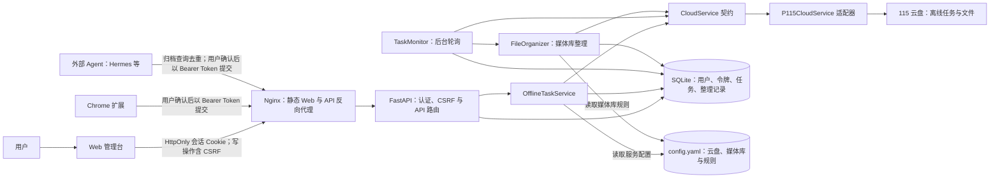
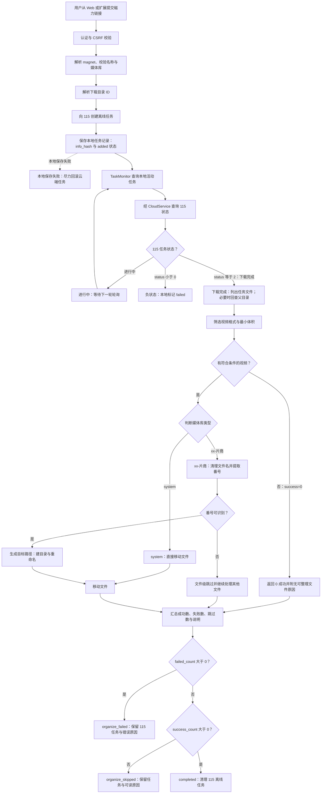
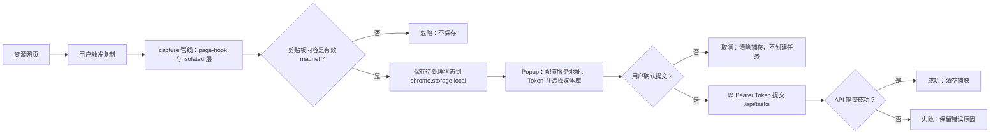
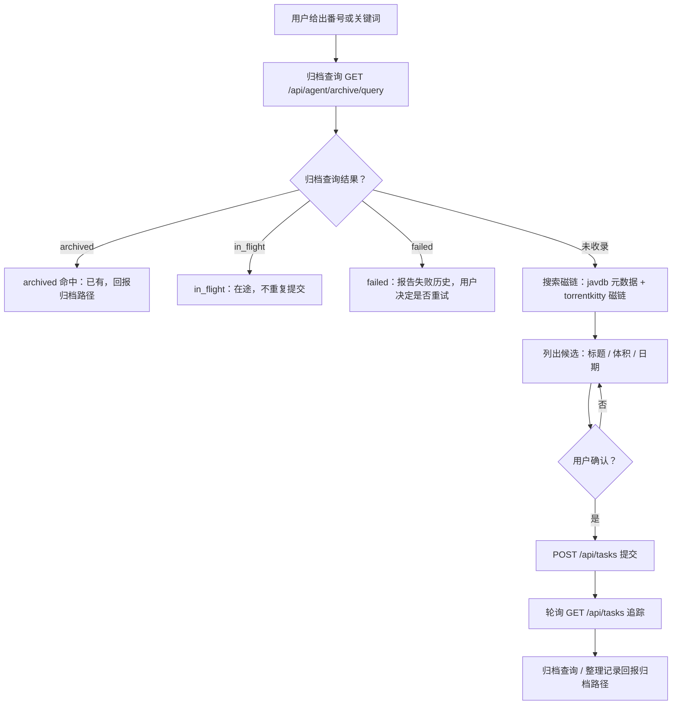
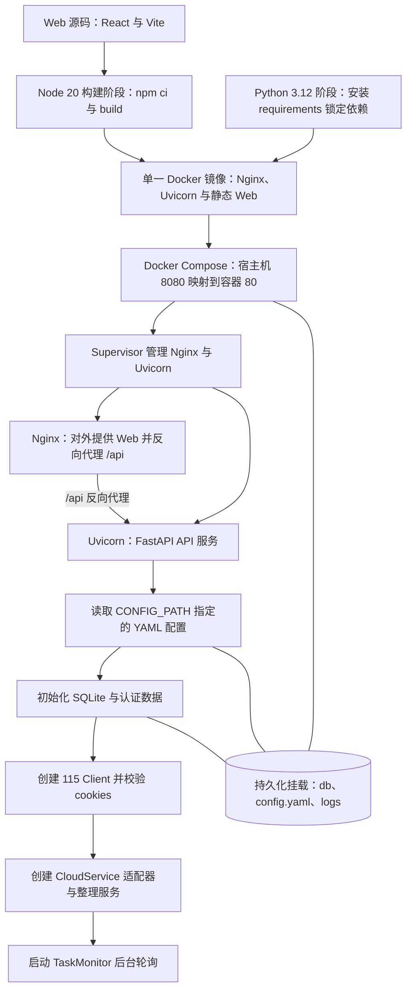

# MediaBridge 项目流程图（Mermaid 源文件）

> 本文件是供 GitHub、Markdown 渲染器及其他模型/Agent 使用的文本版流程图。Mermaid 源码保留节点、分支和连线语义；视觉版见 [project-flow.html](./project-flow.html)。
>
> 基线：`b1839c4`。图示描述以代码实现为准；代码变更涉及流程时，应同步更新本文件和 HTML 视觉版。

## 1. 系统架构与数据流

## 2. 离线任务生命周期

### 终态语义

- `failed`：115 下载任务本身返回负状态。
- `organize_failed`：整理过程中至少一项失败；保留 115 任务和错误原因。
- `organize_skipped`：整理后成功数为 0（包括没有符合条件的视频或所有文件均被跳过）；保留任务与说明。
- `completed`：至少一项整理成功且没有失败；随后清理 115 离线任务。部分文件被跳过不阻止其他文件成功归档。

## 3. 浏览器扩展捕获流程

> 捕获不等于提交：扩展只暂存链接，必须由用户在 Popup 明确确认后才创建任务。

## 4. Agent 找资源接入流程

> Agent 铁律：永不自动提交（候选必须经用户确认）、提交前必查归档、域路由（番号域走 MediaBridge，TMDB 域走 MoviePilot）。
> 接入细节见 `apps/agent/AGENTS.md`；源可用性与搜索实操见 `apps/agent/docs/search-playbook.md`。

## 5. 构建、配置与服务启动

- Compose 将数据库、配置文件与日志目录挂载到宿主机；Supervisor 管理 Nginx 和 Uvicorn。
- 设置保存会校验配置、写回 YAML 并更新运行配置。
- 当前代码中 115 cookies 校验失败会记录错误，但不会因此中止应用初始化。
